<div align="center">


# LocalRush

**A complete, production-grade food delivery ecosystem — customer, rider and restaurant apps, real-time tracking, payments, and an ops dashboard.**

[](backend/)
[](android/)
[](docs/DEPLOYMENT.md#3-map-data-self-hosted-osrm--nominatim)
[](docs/API_CONTRACTS.md)
[](docs/TESTING.md)
[](deploy/)

<br>

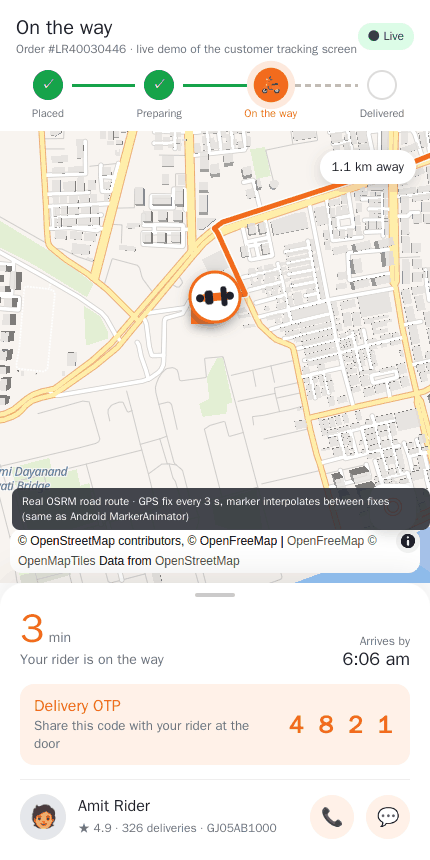

*Live tracking — real road route, smooth animated rider marker, ETA, delivery OTP, call & chat.*

</div>

---

## ✨ Why LocalRush

| | |
|---|---|
| 🛵 **Three native apps, one backend** | Customer, Rider and Restaurant Partner apps (Kotlin + Jetpack Compose) share one API, one database and one design system. No WebViews. |
| 📍 **Real-time tracking that feels right** | Foreground GPS service → validated location stream → Redis → WebSockets → MapLibre map with an interpolated, heading-aware scooter marker. Routes and ETAs from self-hosted OSRM. |
| 💸 **Money handled properly** | Decimal everywhere. Single pricing engine for cart and orders. Razorpay checkout with signature + amount verification, idempotent webhooks, refunds, commission, settlements, rider payouts, ledgers, audit log. |
| 🔒 **Security-reviewed** | OTP + JWT with revocation, object-level authorization, OTP-verified pickup/delivery with lockout, throttles that can't be spoofed, upload sniffing, HSTS. Independent review findings fixed ([SECURITY.md](docs/SECURITY.md)). |
| 🗺️ **Zero paid map APIs** | MapLibre + OpenFreeMap tiles (OSM) + self-hosted OSRM and Nominatim. Scripts build the routing graph and geocoder from any Geofabrik extract. |
| 🧰 **Ops dashboard** | Approvals, orders, live rider map, refunds, settlements, coupons, push campaigns, support, reports, settings. |
| ✅ **Verified** | 54 backend tests, live end-to-end run, 60-user load test, 123 Android unit tests, JVM screenshot renders, minified release builds. |

---

## 📱 Screens

<table>
<tr>
<td align="center">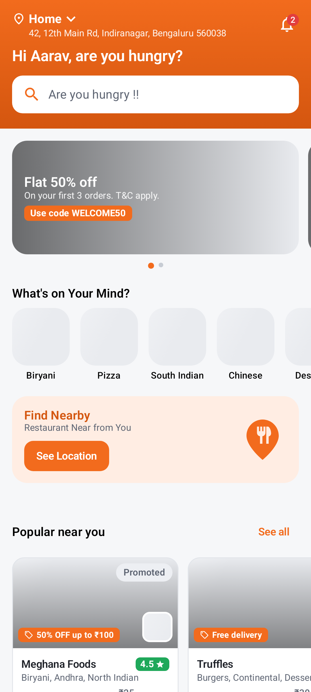<br><sub><b>Customer · Home</b></sub></td>
<td align="center">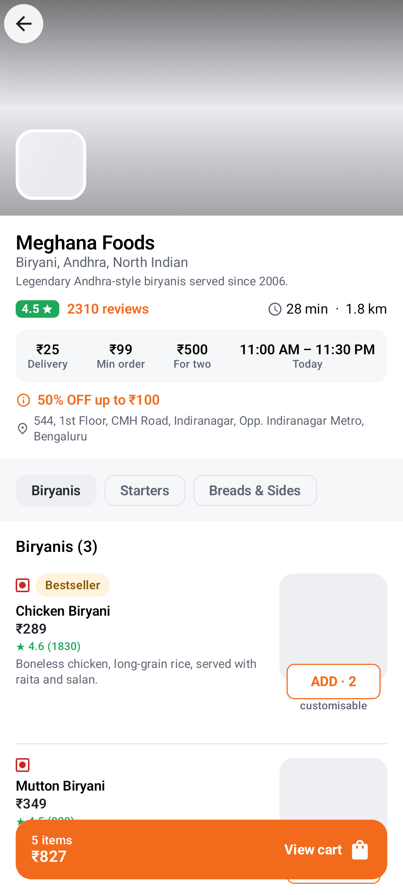<br><sub><b>Customer · Restaurant</b></sub></td>
<td align="center">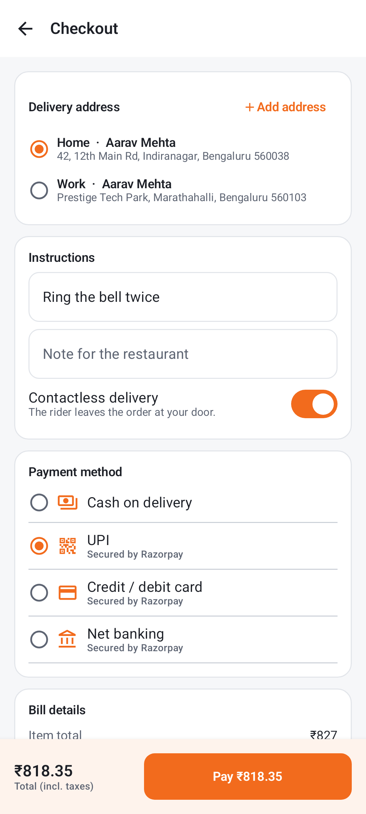<br><sub><b>Customer · Checkout</b></sub></td>
<td align="center">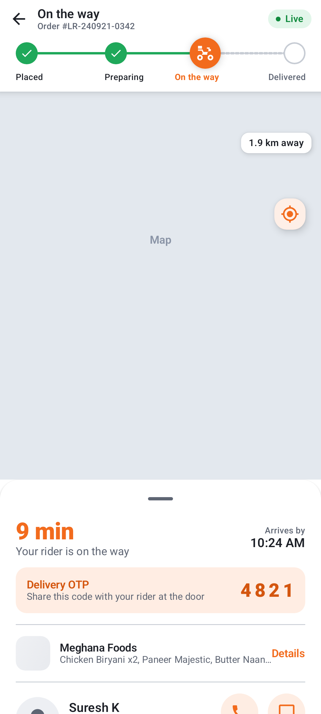<br><sub><b>Customer · Live tracking</b></sub></td>
</tr>
<tr>
<td align="center">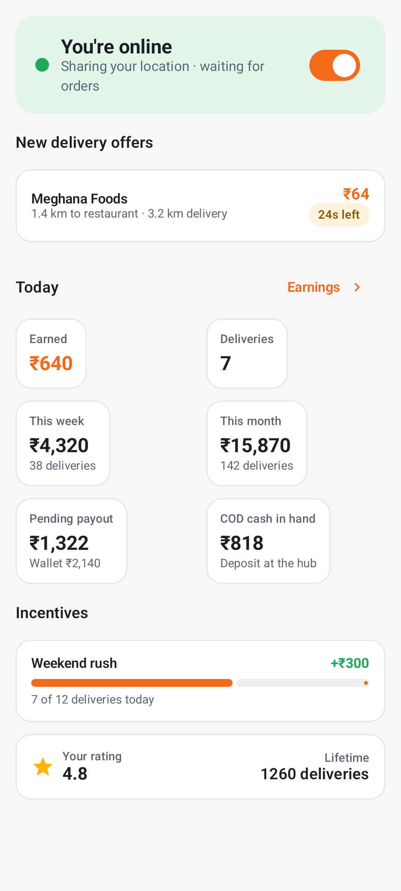<br><sub><b>Rider · Dashboard</b></sub></td>
<td align="center">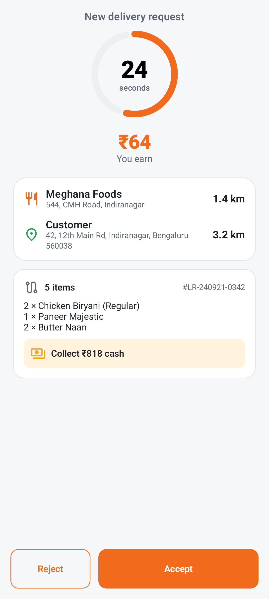<br><sub><b>Rider · Offer</b></sub></td>
<td align="center">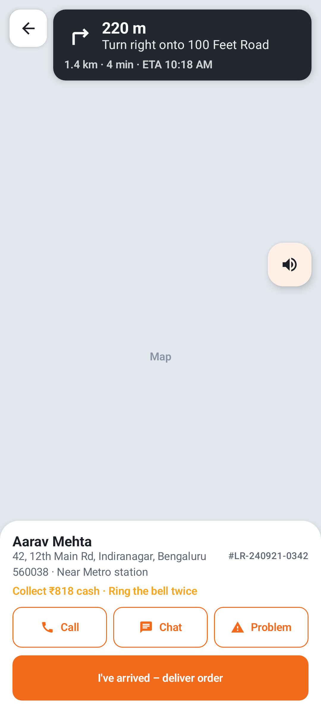<br><sub><b>Rider · Navigation</b></sub></td>
<td align="center">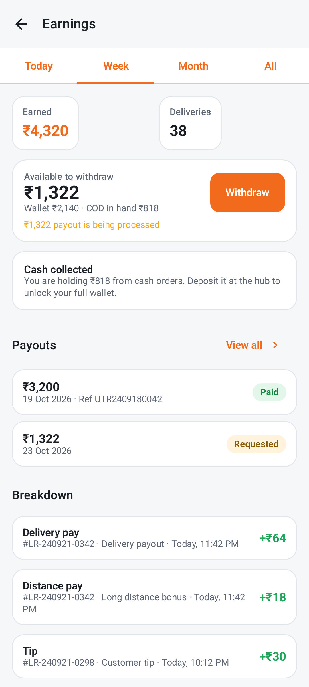<br><sub><b>Rider · Earnings</b></sub></td>
</tr>
<tr>
<td align="center">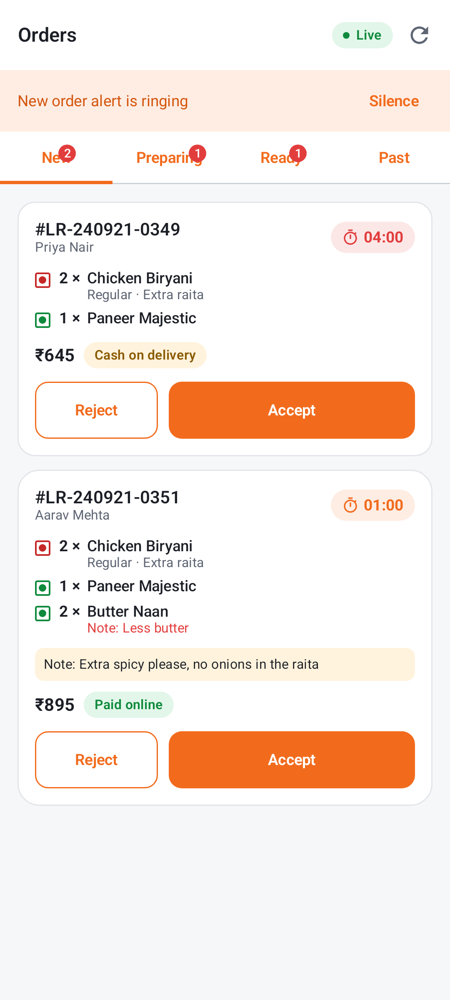<br><sub><b>Partner · Orders board</b></sub></td>
<td align="center">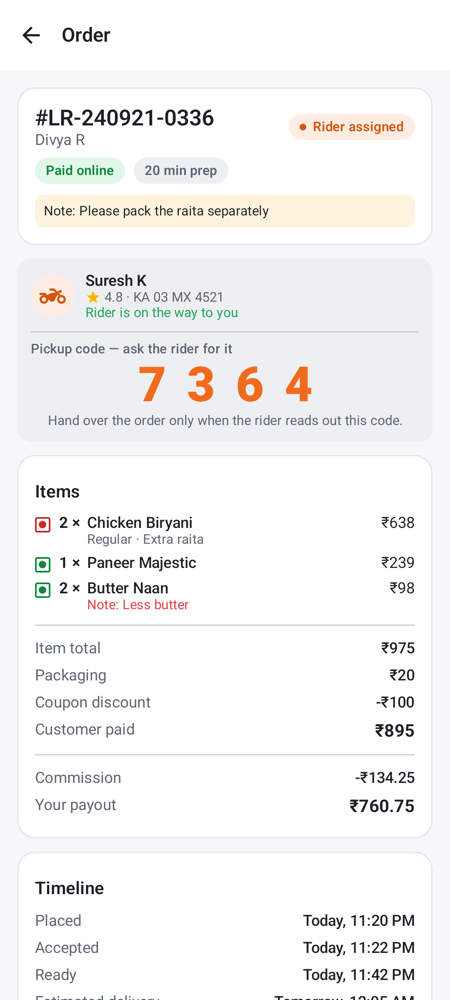<br><sub><b>Partner · Pickup OTP</b></sub></td>
<td align="center">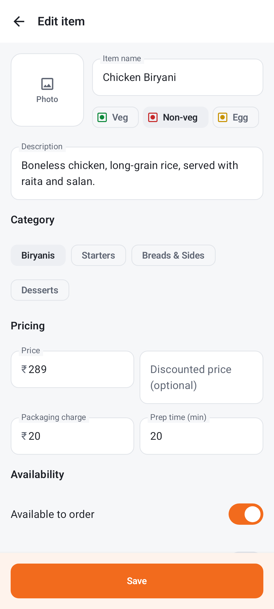<br><sub><b>Partner · Item editor</b></sub></td>
<td align="center">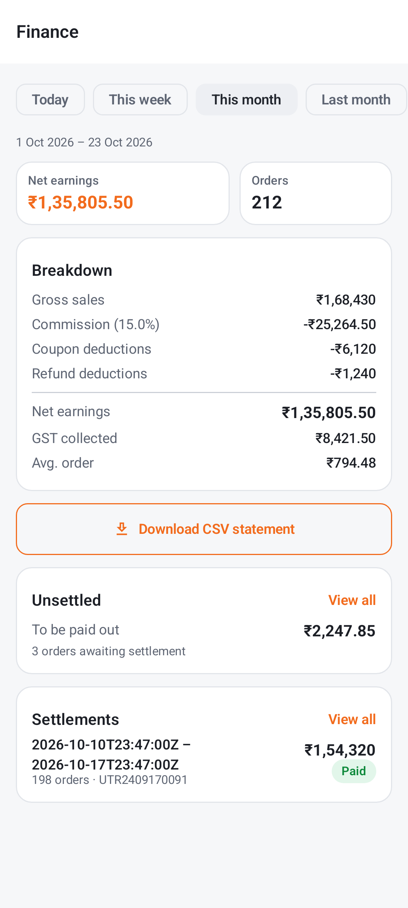<br><sub><b>Partner · Finance</b></sub></td>
</tr>
</table>

<details>
<summary><b>Admin dashboard (14 pages)</b></summary>
<br>
<table>
<tr>
<td align="center">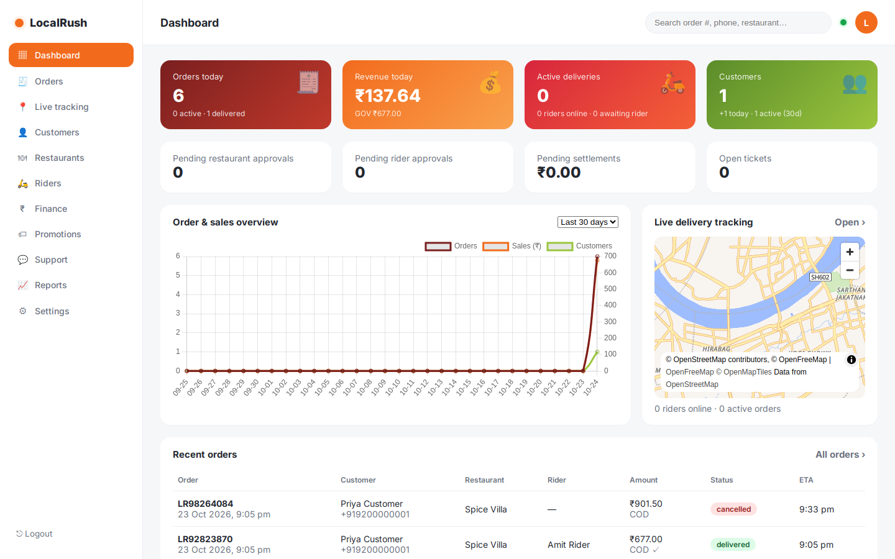<br><sub><b>Overview</b></sub></td>
<td align="center">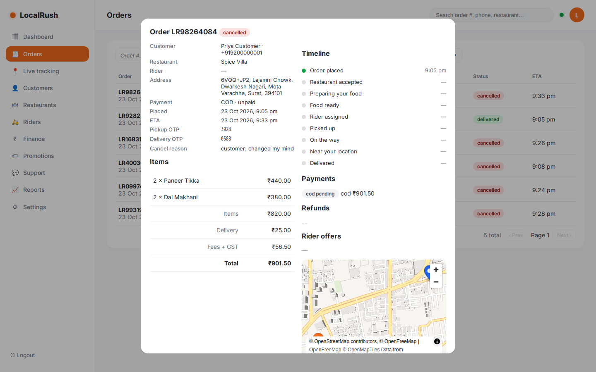<br><sub><b>Order detail</b></sub></td>
</tr>
<tr>
<td align="center">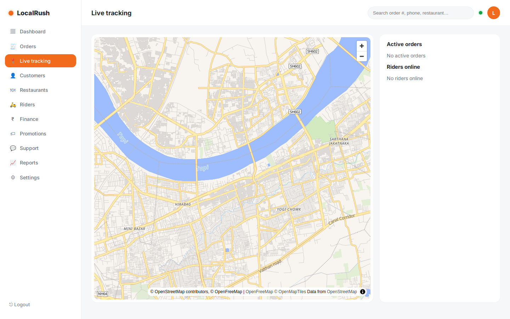<br><sub><b>Live tracking</b></sub></td>
<td align="center">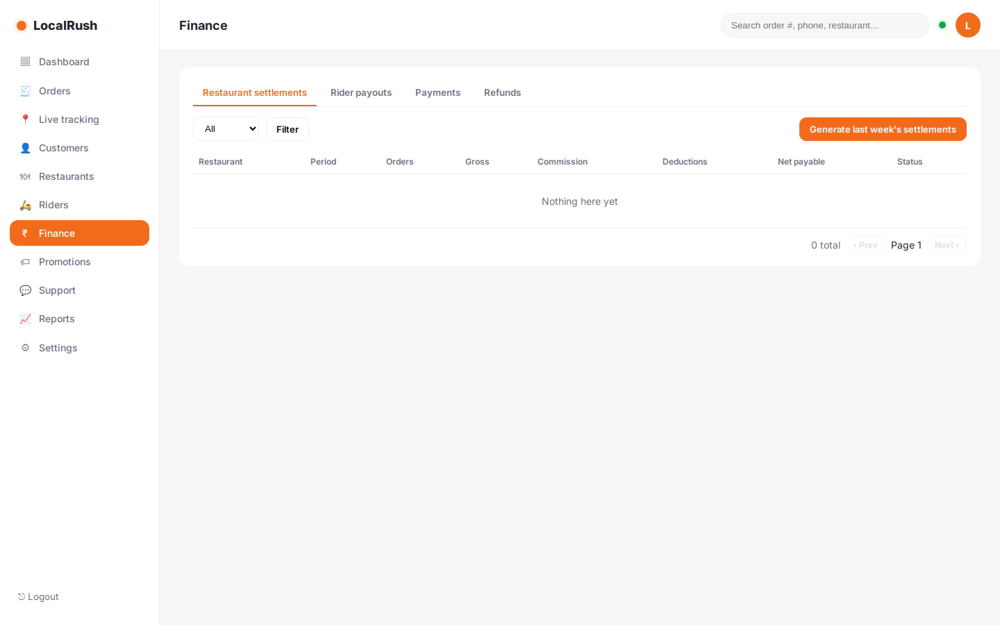<br><sub><b>Finance</b></sub></td>
</tr>
</table>

More: [docs/screenshots/dashboard](docs/screenshots/dashboard) — orders, customers, restaurants, riders, promotions, support, reports, settings, Swagger.
</details>

---

## 🏗️ Architecture

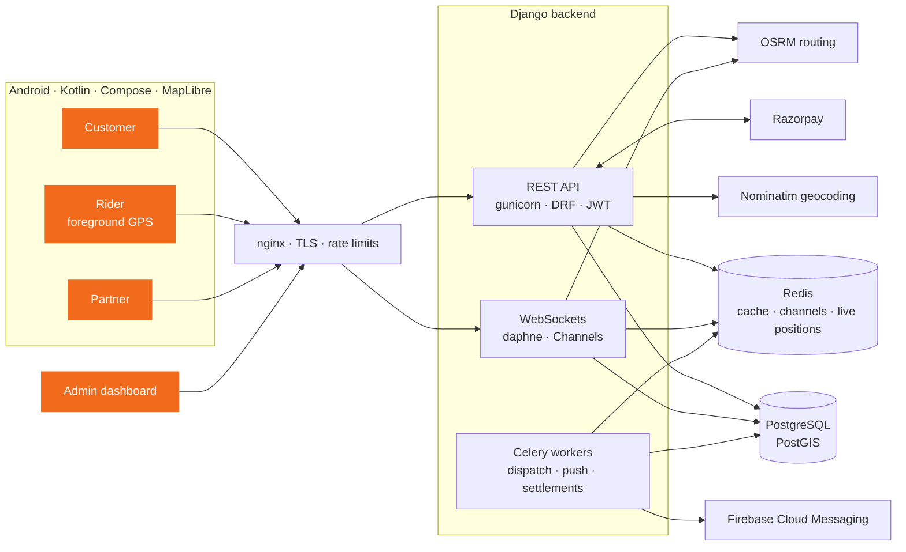

**Order lifecycle** `placed → restaurant_accepted → preparing → ready_for_pickup → rider_assigned → picked_up → out_for_delivery → near_destination → delivered` (+ rejected / cancelled / payment_failed / delivery_failed), enforced by one central state machine with timestamped history and real-time fan-out to every party.

Deep dives: [ARCHITECTURE.md](docs/ARCHITECTURE.md) · [ER_DIAGRAM.md](docs/ER_DIAGRAM.md) · [API_CONTRACTS.md](docs/API_CONTRACTS.md) · [OpenAPI schema](docs/api/openapi.yml)

---

## 🚀 Quick start

> Only Docker + Compose v2 are required. Even the Android apps build inside Docker.

```bash
git clone https://github.com/Officialaashish1/Delivery-App.git LocalRush && cd LocalRush
cp backend/.env.example backend/.env                 # dev defaults; OTP is fixed to 123456 in DEBUG
docker compose up -d                                 # db · redis · api :8001 · worker · beat
docker compose exec api python manage.py seed --demo
```

| | URL / account |
|---|---|
| API docs (Swagger) | http://localhost:8001/api/docs/ |
| Admin dashboard | http://localhost:8001/dashboard/ — `+919999999999` / `admin12345` |
| Demo partner | `+919000000001` — password `partner12345` or OTP `123456` |
| Demo riders | `+919100000001`, `+919100000002` — OTP `123456` |
| Demo customer | `+919200000001` — OTP `123456` |

**Real roads & addresses (optional):**
```bash
deploy/scripts/prepare-osrm.sh https://download.geofabrik.de/asia/india/western-zone-latest.osm.pbf
deploy/scripts/prepare-nominatim.sh https://download.geofabrik.de/asia/india/western-zone-latest.osm.pbf
docker compose --profile maps up -d osrm nominatim
```

**Android apps:**
```bash
cd android
./BUILD.sh :app-customer:assembleDebug :app-rider:assembleDebug :app-partner:assembleDebug
# target your own server instead of the emulator host:
LOCALRUSH_API_BASE_URL=http://<server-ip>:8001/api/v1/ LOCALRUSH_WS_BASE_URL=ws://<server-ip>:8001/ws/ ./BUILD.sh :app-customer:assembleDebug
```
APKs: `android/app-*/build/outputs/apk/debug/`. Or open `android/` in Android Studio.

<details>
<summary><b>Run the tests</b></summary>

```bash
docker compose exec api pytest                 # backend — 54 tests
docker compose exec api ruff check .           # lint
docker run --rm --network localrush_default -v $PWD/backend/scripts:/s:ro python:3.12-slim python -I /s/smoke_e2e.py   # live end-to-end
cd android && ./BUILD.sh testDebugUnitTest     # Android — 123 unit tests
cd android && ./BUILD.sh :app-customer:recordPaparazziDebug   # screenshot renders, no emulator
```
Load test (Locust) and results: [docs/TESTING.md](docs/TESTING.md).
</details>

---

## 🧩 What's inside

<details open>
<summary><b>Backend</b> — <code>backend/</code></summary>

- **Auth**: phone OTP (hashed, throttled, attempt-limited) → JWT access/refresh with rotation, blacklist and per-user revocation; password login for partners/admins; account deletion.
- **Discovery**: PostGIS nearby search, filters/sorts, home sections, unified search, cuisines & categories, banners.
- **Menus & cart**: categories, items, variant groups, add-on groups, stock; server-side single-restaurant cart with customisation validation.
- **Orders**: one pricing engine (items, packaging, distance-based delivery fee, platform fee, GST, coupons), idempotent placement, state machine, auto-reject timeouts, cancellation rules, HTML invoices, reorder.
- **Dispatch**: nearest online rider, timed offers, automatic re-offer/expiry sweeps, admin manual assignment.
- **Payments**: Razorpay orders, checkout signature + amount verification, idempotent webhooks, retries, refunds (incl. duplicate/late captures), COD limits and cash-in-hand.
- **Tracking**: location validation (bounds, accuracy, monotonic time, max speed), Redis hot store, sampled history to PostGIS, WebSocket fan-out, OSRM route refresh when off-route, auto "near destination", in-order chat.
- **Finance**: commission per order, settlement lines, weekly settlements, rider earnings/incentives/payouts, daily platform ledger, CSV statements.
- **Notifications**: FCM push with per-app channels, in-app inbox, deduplicated events, promo campaigns.
- **Admin API + dashboard**, reviews, support tickets & FAQs, audit log, platform settings.
</details>

<details>
<summary><b>Customer app</b> — <code>android/app-customer</code> · <code>in.localrush.customer</code></summary>

Onboarding → location picker (reverse geocoding) → OTP login (guest browsing allowed) → home → search & filters → restaurant with variants/add-ons → cart & coupons → checkout (COD, UPI, card, net banking via Razorpay Checkout) → orders → **live tracking** (snapshot + WebSocket, animated scooter, solid route, ETA, OTP, call/chat) → ratings, invoices, support, profile & addresses. FCM deep links.
</details>

<details>
<summary><b>Rider app</b> — <code>android/app-rider</code> · <code>in.localrush.rider</code></summary>

Registration wizard with documents → admin approval gate → dashboard with online toggle → foreground GPS service (battery-aware, Room offline queue, batch replay) → full-screen offers with countdown → MapLibre navigation with turn-by-turn and voice → arrived / pickup OTP / call / chat / delivery OTP + proof photo → earnings, incentives, payouts, history, problem reporting.
</details>

<details>
<summary><b>Partner app</b> — <code>android/app-partner</code> · <code>in.localrush.partner</code></summary>

Registration with map pin & documents → approval gate → dashboard → real-time orders board with loud new-order alert (accept with prep time, reject, preparing, ready, pickup OTP, rider card) → menu management (categories, items, variants, add-ons, stock, bulk availability) → hours, holidays, closures → finance (summary, lines, settlements, CSV) → reviews with replies → support.
</details>

<details>
<summary><b>Deployment</b> — <code>deploy/</code></summary>

Production Compose (gunicorn API, daphne WebSockets, Celery worker + beat, PostGIS, Redis, OSRM, Nominatim, nginx, certbot, daily backups), Let's Encrypt bootstrap, redeploy script, Prometheus/Grafana stack. Guide: [DEPLOYMENT.md](docs/DEPLOYMENT.md).
</details>

Full file map: [STRUCTURE.md](STRUCTURE.md)

---

## 🛠️ Tech stack


---

## 📚 Documentation

| | |
|---|---|
| [STRUCTURE.md](STRUCTURE.md) | Directory & module map |
| [DEVELOPMENT_STATUS.md](DEVELOPMENT_STATUS.md) | Phase status, verification log, limitations |
| [docs/ARCHITECTURE.md](docs/ARCHITECTURE.md) | System design & request flows |
| [docs/ER_DIAGRAM.md](docs/ER_DIAGRAM.md) | Data model |
| [docs/API_CONTRACTS.md](docs/API_CONTRACTS.md) · [openapi.yml](docs/api/openapi.yml) | REST, WebSocket & push contracts |
| [docs/DEPLOYMENT.md](docs/DEPLOYMENT.md) | Production VPS guide & external services |
| [docs/TESTING.md](docs/TESTING.md) | Suites, E2E, load test |
| [docs/SECURITY.md](docs/SECURITY.md) | Controls, review findings & fixes |
| [docs/PLAYSTORE_RELEASE.md](docs/PLAYSTORE_RELEASE.md) | Signing, AAB, Play Console |
| [docs/DEMO_GUIDE.md](docs/DEMO_GUIDE.md) | 10-minute demo on real phones |
| [docs/android/DESIGN_BRIEF.md](docs/android/DESIGN_BRIEF.md) | Screen-by-screen design spec |

---

## 🧭 Going to production

1. Fill `backend/.env` — secret key, DB/Redis passwords, Razorpay keys + webhook secret, SMS provider (MSG91/Twilio), `DB_POOL=true`.
2. Add Firebase: `secrets/firebase.json` on the server, `google-services.json` in each app module.
3. Build map data for your region (`deploy/scripts/prepare-osrm.sh`, `prepare-nominatim.sh`).
4. `cd deploy && DOMAIN=api.example.com EMAIL=ops@example.com ./scripts/init-letsencrypt.sh && docker compose -f docker-compose.prod.yml --env-file ../backend/.env up -d --build`
5. Sign and ship the apps — [docs/PLAYSTORE_RELEASE.md](docs/PLAYSTORE_RELEASE.md).
